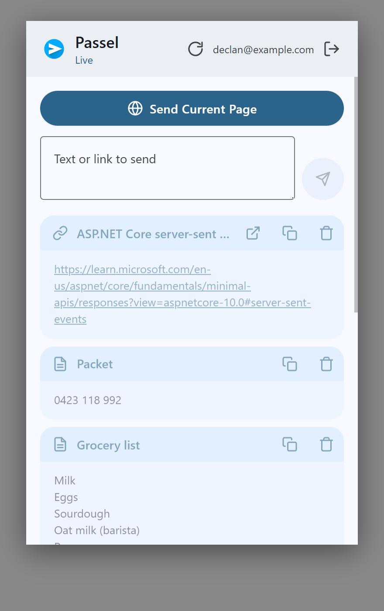
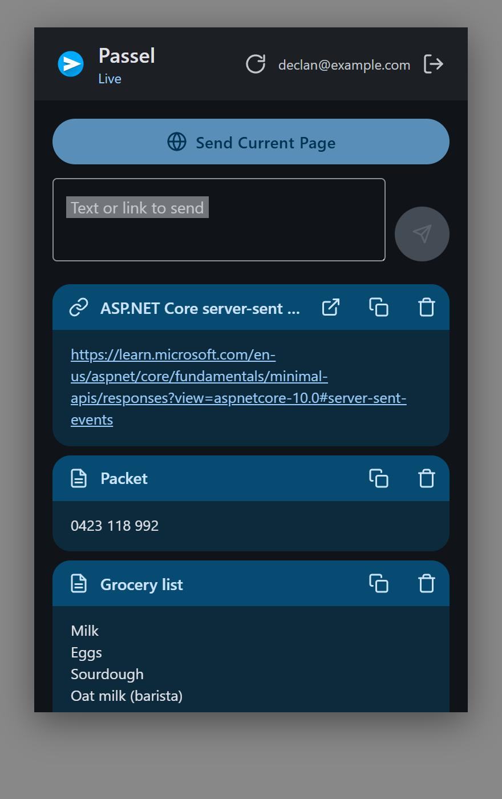
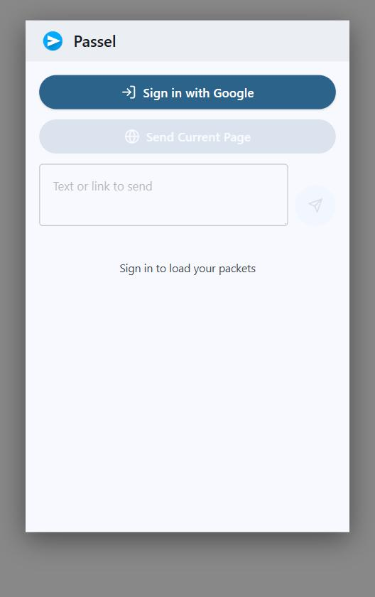
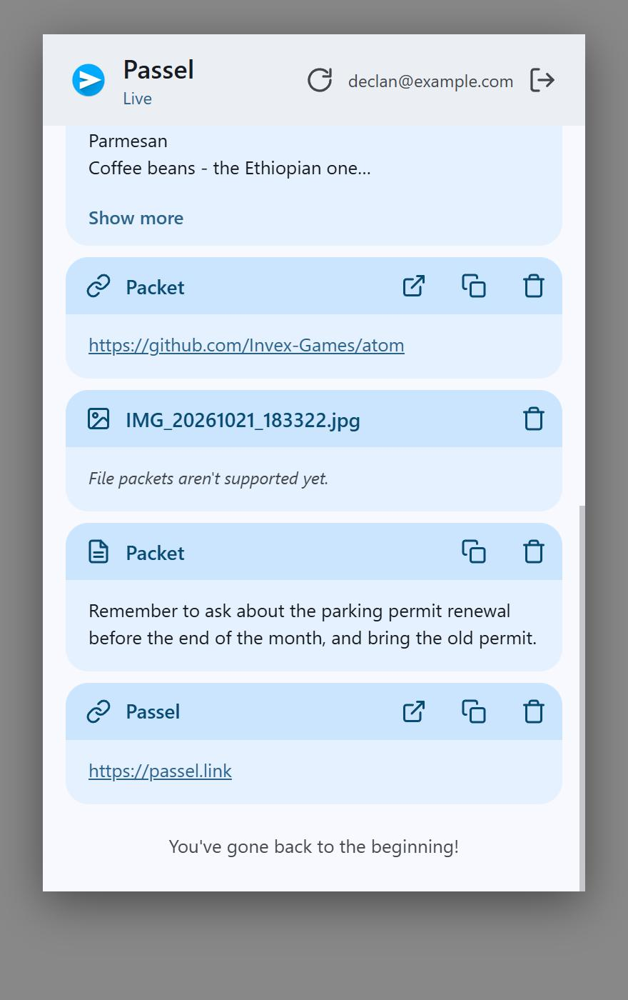
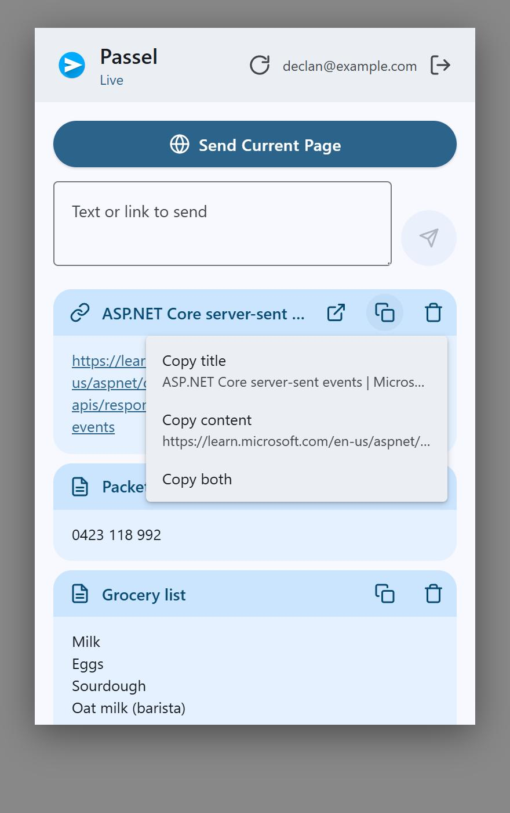
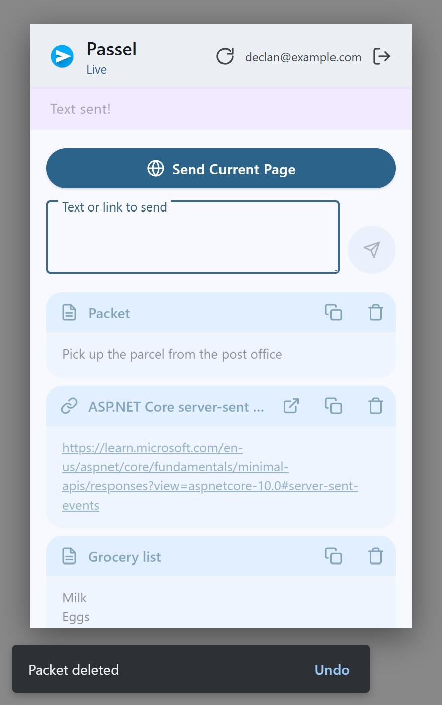

# UI Design

Scope: how the clients look, as opposed to how they work ([User Experience](ux.md)). The extension popup was rendered from the real bundle with sample data; the screenshots below are in `images/`. The mobile app was reviewed from its widgets and theme, not from a device, so its findings are about structure and colour rather than pixel polish.

| Feed (light) | Feed (dark) | Signed out |
|---|---|---|
|  |  |  |

| Scrolled feed | Copy menu | After sending |
|---|---|---|
|  |  |  |

## Verdict

Clean, consistent and clearly Material 3: both clients use the same seed colour and token set, dark mode is correct, and the mobile app picks up Material You dynamic colour. What holds it back is the tile. Every item is drawn as a small window with a saturated title bar and three always-visible buttons, so the feed is heavy, repetitive and low on information: a link looks like a note looks like a file, there is no time or source, and link bodies are raw URLs. The composer also takes a quarter of the popup permanently. The fix is a lighter list item with better metadata, not a new design language.

Score: 3 / 5.

## Strengths

- One palette, two platforms: `popup.css` carries the full MD3 token set (light and dark) generated from the same seed as `theme.dart`, so the extension and the app feel related.
- Dark mode is a first-class citizen (`prefers-color-scheme` in the popup, `darkTheme` plus dynamic colour on Android) and reads well.
- MD3 components are reproduced faithfully by hand in the popup: filled and tonal buttons, outlined text field with a floating label, menu, snackbar, icon buttons with state layers.
- Motion is restrained and purposeful: tiles slide in, the app bar collapses on scroll, the refresh indicator has a proper armed state, and the mobile list staggers entrance animations.
- Loading and feedback states exist for every action (button spinners, "Sending…", undo snackbars, "Live" indicator).

## Findings

1. **Tile anatomy is heavy (Medium).** Each tile has a 48 px `primary-container` header strip holding an icon, the title and two or three icon buttons, over a pale body (`popup.css` `.packet-header`, `tile_header.dart`). Three and a half tiles fit in the popup. The strips are the most saturated thing on screen, so the eye lands on chrome rather than content, and a list of twenty items is twenty identical blue bars.

2. **Types are not differentiated (Low).** The only difference between a link, a note and a file is an 18 px glyph. Colour, shape and layout are identical.

3. **Link bodies are raw URLs (Medium).** A long URL wraps over four lines and dominates the tile (`images/extension-feed-light.jpg`). There is no favicon, host or preview image.

4. **No metadata line (Medium).** Nothing shows when an item was sent or from where. This is an API gap first ([UX](ux.md) finding 3) but it also leaves the tile with nothing to put in a secondary line.

5. **"Packet" placeholder titles (Low).** Every untitled item gets a bold title that says "Packet".

6. **The composer is always expanded (Low).** "Send Current Page", a two-row text area and a send button occupy about 150 px of the 600 px popup before the first item.

7. **Two feedback styles and a layout shift (Low).** The status bar is in normal flow and pushes everything down when it appears (`images/extension-send-status.jpg`); the toast overlays. One snackbar should do both jobs.

8. **Bare signed-out and empty states (Low).** A single button over a greyed-out composer, and a single sentence of text.

9. **Thin branding (Low).** The paper-plane icon appears in the popup header and store icons, but the mobile login page uses `Icons.send_rounded` (`login_page.dart`) rather than the logo, there is no wordmark, and the docs site uses the icon with default theming. A small brand kit (logo, wordmark, colour, icon style, tone of voice) would tie the clients and the coming web app together.

10. **Icon sets differ (Low).** The popup draws its own line icons as inline SVG paths (`popup.ts` `ICONS`), the app uses Material Icons. The link and delete glyphs differ between clients.

11. **MD2-style app bar on mobile (Low).** `packet_feed_page.dart` colours the app bar with `inversePrimary`, a light blue band. MD3 top bars sit on surface colours and tint on scroll; the band dates the screen and competes with the tiles.

12. **Popup type is small (Info).** Body text is 13 px and titles 14 px; MD3 body-medium is 14 px and title-medium 16 px. Fine for a dense popup, but the web app should not inherit it.

## Direction

Keep the tokens, drop the window chrome. The proposed list item for all three clients:

```
[favicon or type glyph]  Title or host                          2h
                         learn.microsoft.com/en-us/aspnet/...  (links)
                         First line of the note…               (notes)
                         IMG_20261021.jpg · 1.2 MB · thumbnail (files)
```

- **Leading:** the site favicon for links (fetched server-side once with the link preview, or from a favicon service as a stopgap), a tonal circle with a glyph for notes and files, a square thumbnail for images.
- **Title line:** the real title, else the host for links or nothing for notes. Never a placeholder word.
- **Secondary line:** host or snippet, truncated to one line; relative time right-aligned; day headers ("Today", "Yesterday", "14 October") between groups.
- **Actions:** on desktop, revealed on hover and in an overflow menu; on mobile, swipe and long-press, with the open action on tap. Delete stays reachable by keyboard.
- **Surfaces:** items on `surface-container-low` over a `surface` background, no header strip. Reserve `primary` for the send button and FAB. Use `tertiary-container` for file items and `secondary-container` for notes if type colour is wanted; keep it subtle.
- **Tap:** opens the link, or expands the note in place (desktop) or opens a detail page (mobile) with full text, selectable, with copy and share.
- **Density:** aim for six to eight items per popup screen.

Composer: make "Send current page" the one prominent button and collapse the note field to a single row that grows when focused. Put the account in an avatar menu instead of spelling out the email in the header.

States: the signed-out popup gets the logo, one sentence, the sign-in button and a link to the phone app; the empty feed gets three tips. Both get a simple illustration from the brand kit.

## Options for building it

| Option | Pros | Cons |
|---|---|---|
| **Keep the hand-rolled MD3 CSS** in the extension and share it with the web app as a small CSS and component package | Already works, tiny, matches `theme.dart` exactly, no framework lock-in | Every component is bespoke; menus, dialogs and sheets need writing and testing by hand |
| **Google's `@material/web` components** | Official MD3 look, accessible, framework-agnostic web components | Google put the project in maintenance mode in 2025; limited components (no list item, no navigation rail), uncertain future |
| **A framework kit (MUI for React, Vuetify for Vue, Beer CSS for plain HTML)** | Complete component sets, themable from the same tokens, active maintenance | Pulls a framework into the extension or diverges the extension from the web app |

Recommendation: keep the hand-rolled tokens and grow them into a shared `@passel/ui` package consumed by both the extension and the web app, adding only the components the design above needs (list item, day header, snackbar, sheet, menu, avatar menu). The mobile app keeps Flutter's Material components with the same tokens. Revisit a framework kit only if the web app grows well past the feed.

## Steps forward

1. Decide the vocabulary and ordering ([UX](ux.md) findings 4 and 5) so the redesign uses them.
2. Add `CreatedAt` to the API (needed for the metadata line).
3. Redesign the list item in the extension first (smallest surface, fastest to iterate), using the harness approach from this review to preview it without loading the extension.
4. Port the item, day headers and states to the mobile app; replace the `inversePrimary` app bar with a surface-coloured one.
5. Produce a small brand kit (logo, wordmark, icon style, illustrations for empty states) and apply it to the login page, the signed-out popup and the docs site.
6. Use the same tokens and components in the web app from day one.
